# Elementary school website

The website of Základní škola a Mateřská škola, Moravský Písek, příspěvková organizace, rebuilt from a static site that was over 10 years old. It has a simple, clear layout for parents, teachers and pupils, works on phones, has a light and a dark theme, and comes with an admin where the school edits news, contacts, documents, galleries and the school year calendar itself.

- **Web:** Next.js 16 (App Router, React 19, TypeScript) with Bootstrap 5 and plain CSS (BEM, one file per block in `src/web/app/styles/`), in `src/web`
- **Data:** PostgreSQL 18 through Prisma 7; photos and documents in a media folder on the server
- **Running:** Docker Compose on an AlmaLinux VM, with Caddy in front for HTTPS (see [Server setup](#server-setup-almalinux-vm))
- **Checked with:** ESLint (with the jsx-a11y accessibility rules), Prettier, and axe (WCAG 2.2 AA) on every page in both themes, on desktop and phone

Developers start in [`src/web/README.md`](src/web/README.md).

## Screenshots

| Light                                                                 | Dark                                                              |
| --------------------------------------------------------------------- | ----------------------------------------------------------------- |
| 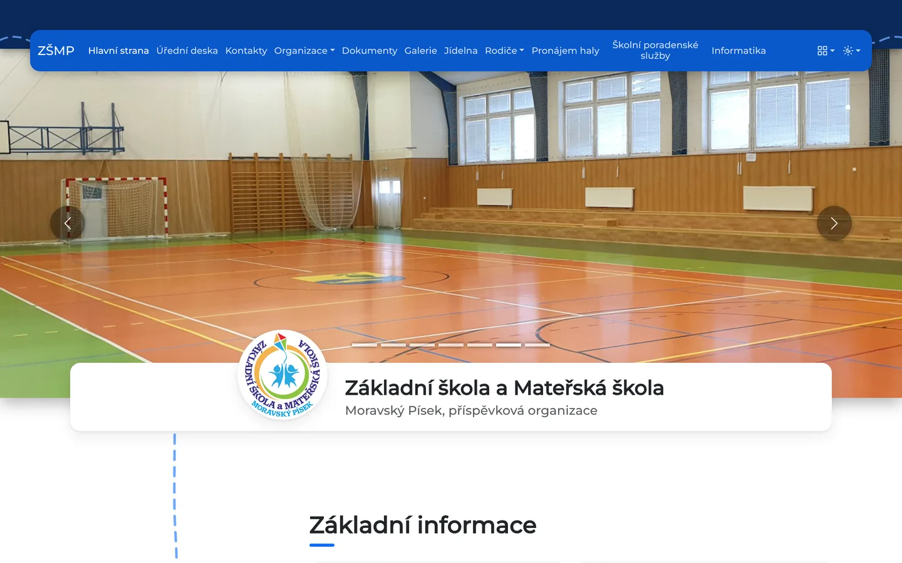   | 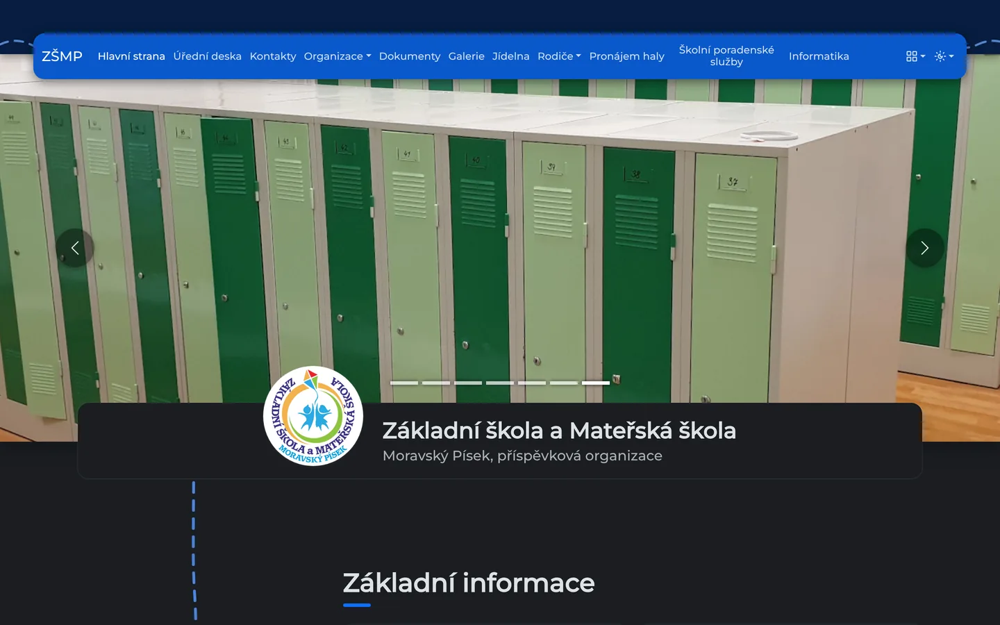 |
| 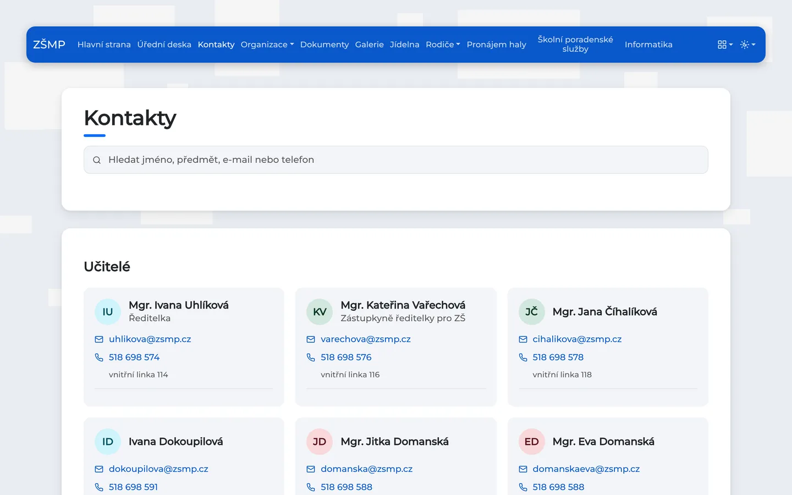 | 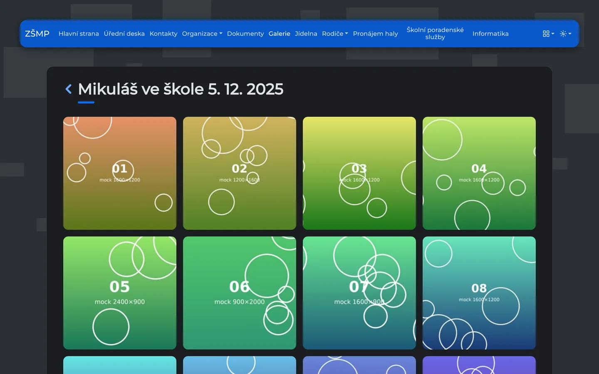            |

On a phone:

| Home                                                            | Home, dark                                                                 | Photo archive                                                          | School year                                                                               |
| --------------------------------------------------------------- | -------------------------------------------------------------------------- | ---------------------------------------------------------------------- | ----------------------------------------------------------------------------------------- |
| 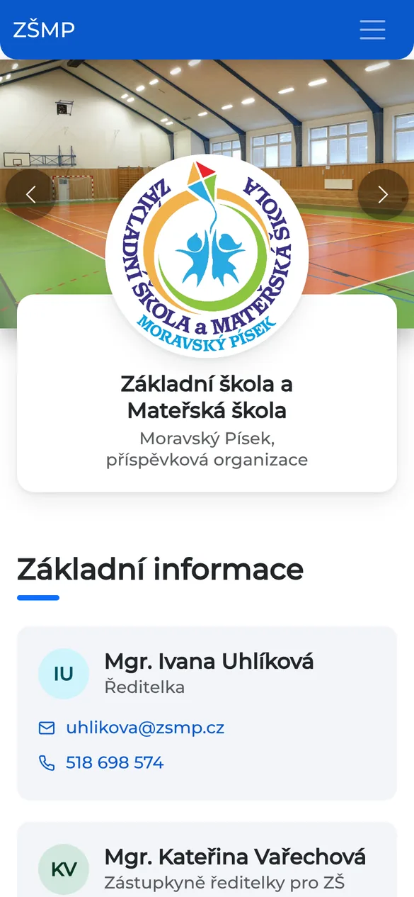 | 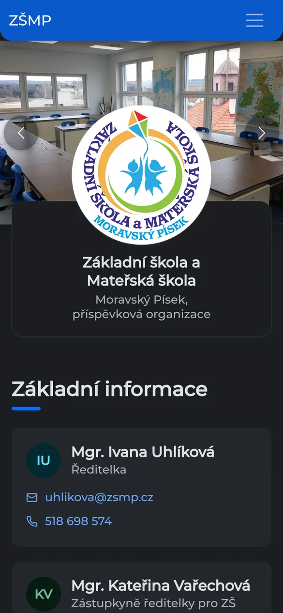 | 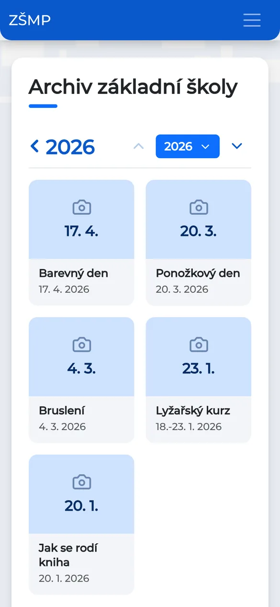 | 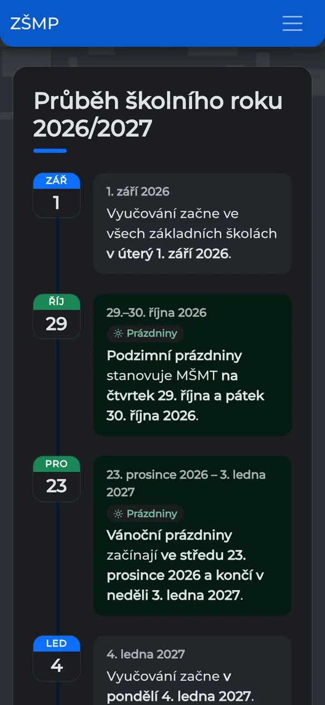 |

The admin:

|                                                             |                                                               |
| ----------------------------------------------------------- | ------------------------------------------------------------- |
| 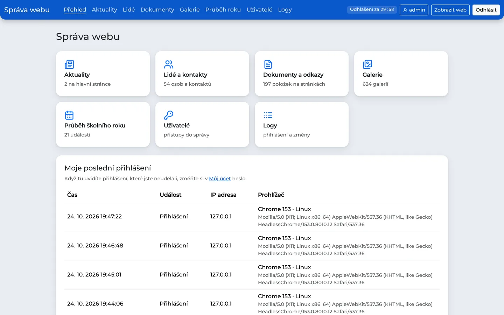   | 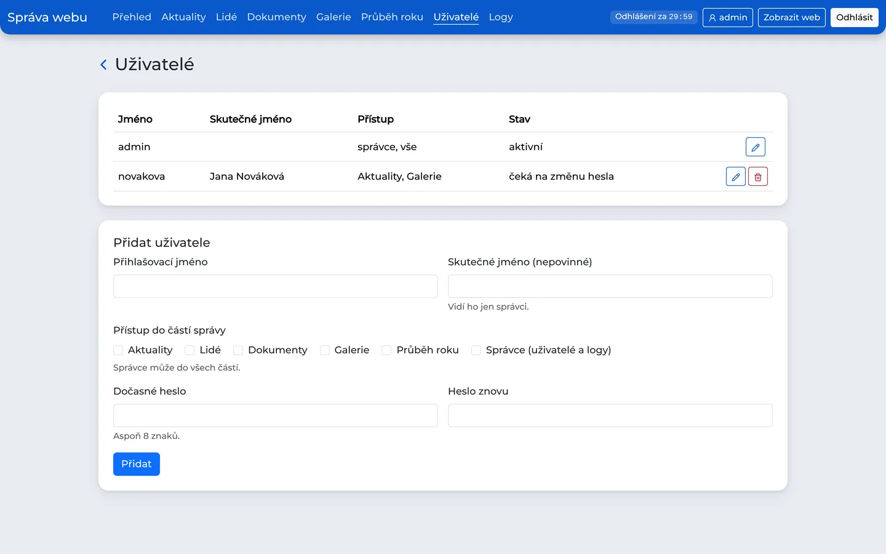  |
| 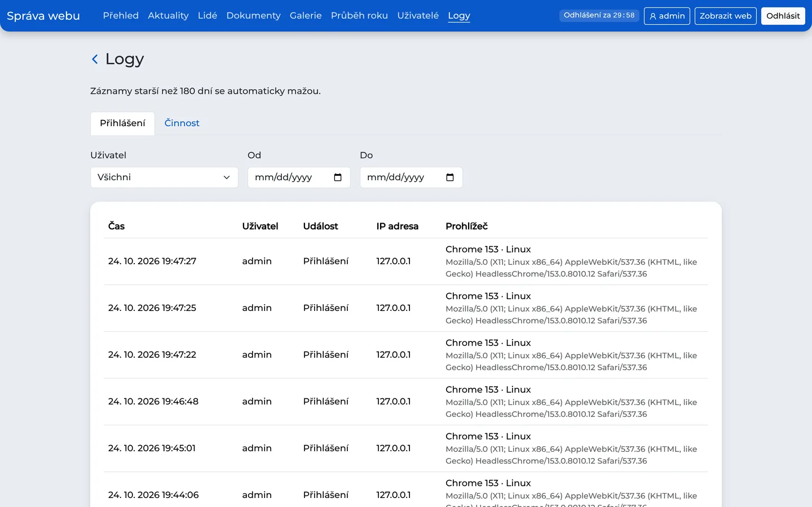                   | 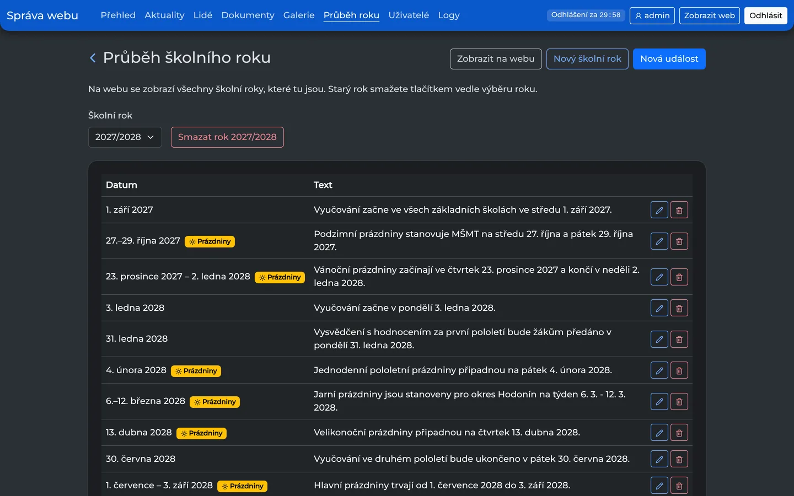 |
| 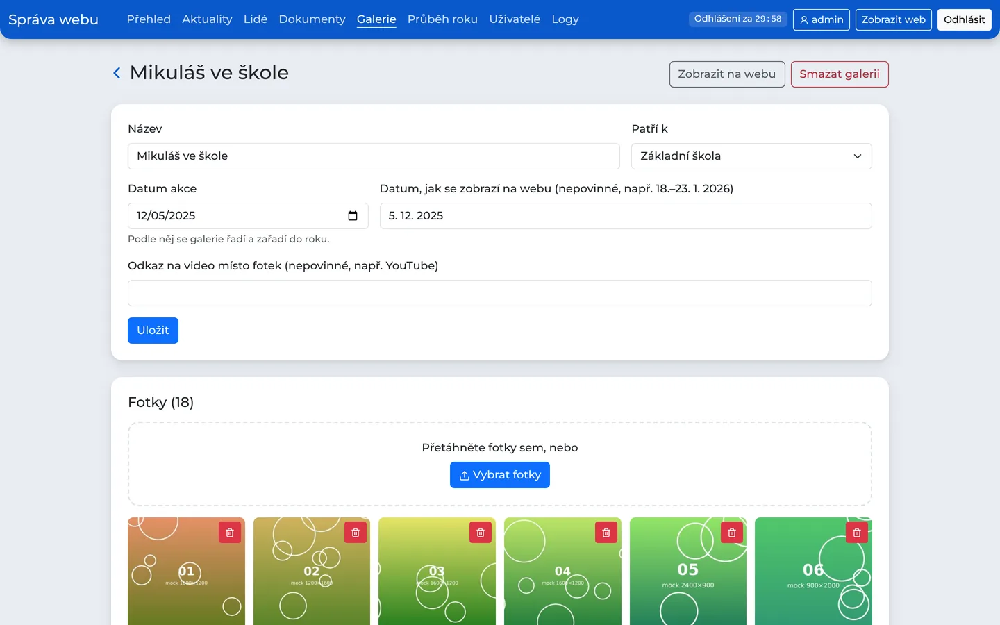 | 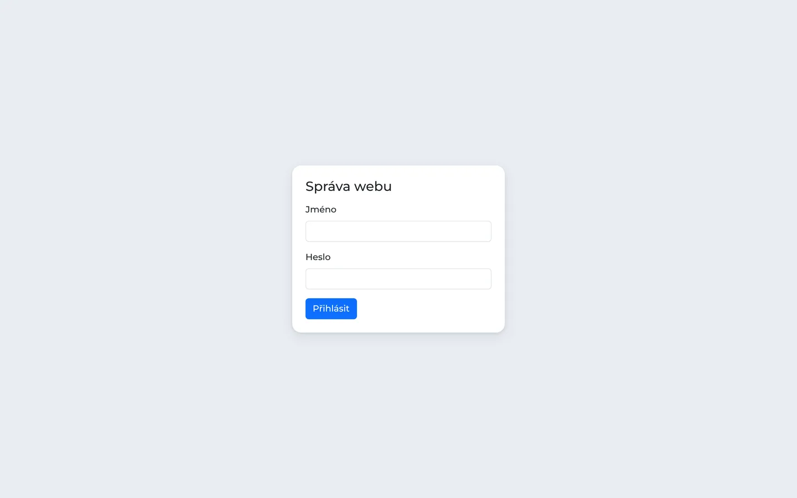            |

## Run with Docker

The site runs as four containers: `caddy` (the public web server with HTTPS, `deploy/caddy/Caddyfile`), `web` (Next.js with the admin, `src/web`), `db` (PostgreSQL 18, `src/db`) and `migrate`, which runs once on every start: it applies new database migrations and fills an empty database.

```bash
cp .env.example .env    # then set a real POSTGRES_PASSWORD; on a dev machine also SITE_ADDRESS=:80
docker compose up -d --build
```

The site is then on http://localhost (through Caddy) and http://localhost:3000 (directly).

## Admin (`/auth`)

`/admin` is the sign-in page. It is not linked from the site and is hidden from search engines (`noindex`); outside the allowed networks it does not exist at all (see [Access by IP address](#access-by-ip-address)). The first user is **admin / zsmp** and has to choose its own password after signing in; until then _Můj účet_ is the only page it can open. Everything else lives under `/auth`, and every page and every change checks the session on the server.

| Section         | What it edits                                                                                   | Permission        |
| --------------- | ----------------------------------------------------------------------------------------------- | ----------------- |
| Aktuality       | news on the home page (title, date, text, optional link, published or not)                      | `aktuality`       |
| Lidé            | people and phone numbers on Kontakty, the home page and the other pages                         | `lide`            |
| Dokumenty       | the lists of documents and links on every page: upload a file or enter a link, replace, reorder | `dokumenty`       |
| Galerie         | galleries of the three archives (ZŠ, MŠ, družina) and their photos                              | `galerie`         |
| Průběh roku     | the calendar on _Průběh školního roku_                                                          | `kalendar`        |
| Pozadí          | seasonal pictures behind the top of the pages: name, SVG/PNG/WebP upload, date range each year  | `pozadi`          |
| Uživatelé, Logy | user accounts and the logs                                                                      | `admin` (Správce) |

- **Access (ACL):** an admin gives each user the sections they may edit. _Správce_ can do everything, including Uživatelé and Logy. A section a user has no access to is hidden from their menu, and opening it anyway sends them back to the start page. Real names of users are visible only to admins. Every user changes their own sign-in name and password under _Můj účet_ (`/auth/ucet`); both changes need the current password.
- **Logs:** sign-ins, sign-outs, wrong passwords, locked accounts and account changes (with the IP address and browser), and every change made in the admin (who, when, what). Admins see them under _Logy_ (`/auth/logy`), filtered by user and date; every user sees their own last sign-ins on the start page, to notice one they didn't make. Entries are deleted after `LOG_RETENTION_DAYS` (180 by default), because IP addresses are personal data (GDPR).
- **Time limits** (`src/web/lib/auth/config.ts`, each one can be changed in `.env` without a rebuild): sign-out after `AUTH_INACTIVITY_MINUTES` (30) without activity, counted down by the timer in the header; the server ends the session too, even with the tab closed. A sign-in lasts at most `AUTH_SESSION_MAX_MINUTES` (480). `AUTH_LOCKOUT_ATTEMPTS` (5) wrong passwords in a row lock the account for `AUTH_LOCKOUT_MINUTES` (10); an admin can unlock it under Uživatelé.
- **Pozadí:** each background has a date range that repeats every year and may wrap past New Year (1. 12. – 31. 1.); one without dates is the default for all other days, and when ranges overlap the shorter one wins. Pages load `/pozadi`, a 5-minute redirect to today's picture, so pages stay static and a change shows up within minutes. Uploads go to `pozadi/` in the media folder; the original three pictures stay in `public/data/images/background_elements/`.
- **Průběh roku:** events with a date (or a date range), the school year they belong to, a text (`**bold**` works) and a holiday flag; holidays are green on the site. A new school year starts empty or as a copy of an earlier one with every date moved by a year, and a whole year can be deleted.
- **Galleries:** a gallery has a title, a unit (ZŠ, MŠ, družina), a date, optionally the date as shown on the site (e.g. "18.–23. 1. 2026") and a video link (e.g. YouTube) instead of photos. Archives are ordered by year and date, newest first. Photos are dragged onto the page and uploaded one by one with a progress bar; the server rotates them by their EXIF data and makes the previews (`thumbnails/`, short side 256 px). Single photos or whole galleries can be deleted.

The sign-in cookie (`zsmp_session`, httpOnly) only travels over HTTPS (Caddy). To try the admin over plain http, set `SITE_ADDRESS=:80`, `COOKIE_SECURE=false` and `ADMIN_ALLOWED_IPS=*` in `.env` for that time. The database keeps only a hash of the cookie's token.

### Access by IP address

The admin answers only to the school network and the VPN. From any other address, `/admin`, everything under `/auth`, the admin's server actions and the photo upload return the site's ordinary 404 page, the same as a mistyped address, so nobody outside can tell there is an admin at all. It is an extra layer: the sign-in, lockout and permissions work as before.

- **Setting:** `ADMIN_ALLOWED_IPS` in `.env`, IP addresses and CIDR ranges separated by commas, IPv4 or IPv6, on the school server `10.0.193.0/24,10.212.134.0/24` (school LAN and the VPN's address pool). Empty means nobody (the admin is locked until it is set), `*` means everyone. On a dev machine (`npm run dev`) an unset value means everyone. Change it and run `docker compose up -d` (no rebuild).
- **Where it is checked:** `src/web/proxy.ts` (Next.js Proxy) with `lib/adminAccess.ts` and `lib/clientIp.ts`. Requests with a server action are checked on every address, because Next.js accepts an action posted to any page.
- **The real address behind Caddy:** the container sees only Caddy, so the browser's address comes from the `X-Forwarded-For` header. A browser can send that header itself, but Caddy ignores it and sets the address it saw; the app trusts only the last entry. Faking it would mean reaching the `web` container without Caddy, and it is published only on 127.0.0.1. The FortiGate's port forward must keep the visitor's address (no source NAT on that policy). The same address goes into the sign-in logs.
- **Admins at school and on the VPN** must reach the VM directly, not through the public address, or the FortiGate may replace their address with its own. Have `zsmp.cz` resolve to the VM's LAN address inside the school network and the VPN (internal DNS on the domain controller, or a hosts entry); the HTTPS certificate still fits. The address Caddy saw is in _Logy_ next to every sign-in, so after the first sign-in over the VPN, check that it is from the VPN range. If you lock yourself out, set `ADMIN_ALLOWED_IPS=*` in the VM for a moment.
- **Why not in Caddy:** Caddy would give its own error page instead of the site's 404, would not catch server actions posted to public pages, and would split the setting between the Caddyfile and `.env`.

## Privacy (GDPR)

The public site stores nothing about visitors: no analytics, no ads, no third-party scripts or fonts (Montserrat is served by the site itself). The browser keeps only the chosen theme, the list layout and that the cookie notice was read, in `localStorage`; the cookie notice says so. The admin stores the sign-in cookie and the logs described above, which are deleted after `LOG_RETENTION_DAYS`.

## Photos, documents and videos

They are not in git or in the image. They live in a folder on the server (`MEDIA_DIR` in `.env`, default `./media`), which is mounted into the web container, so they survive rebuilds:

```
media/
  galerie/<folder>/...   → /galerie/<folder>        (photos, thumbnails/ = previews)
  dokument/...           → /dokument/...
  pozadi/...             → /pozadi/...              (background pictures uploaded in Pozadí)
  videos/zsmp.mp4, zsmp.cs.vtt → /data/videos/...
```

The admin uploads into `galerie/`, `dokument/` and `pozadi/`, so the folder must be writable for the container's user (uid 1000): `sudo chown -R 1000:1000 media`. New files are served right away.

## Database

- The data lives in the Docker volume `db-data`, which survives restarts and rebuilds. Back it up with `docker compose exec db pg_dump -U zsmp zsmp > backup.sql`.
- Prisma owns the tables: `src/web/prisma/schema.prisma` and the migrations in `src/web/prisma/migrations/`. The `migrate` service applies them on every `docker compose up`.
- The first content (as it was in `src/web/data/*.ts`) is `src/web/prisma/seed/content.sql`; it is loaded only into an empty database. From then on the content is edited in the admin.
- If you started the database before Prisma took over (its tables came from `src/db/init/`), either start from scratch with `docker compose down -v` (this deletes all data in it) or keep it with `docker compose run --rm migrate npx prisma migrate resolve --applied 0_init` and then `docker compose up -d`.
- The database listens only on 127.0.0.1:5432 inside the VM. To open it in DBeaver or pgAdmin, use their SSH tunnel option to the VM.

## Web server (Caddy)

The `caddy` container is the public web server, so no IIS or nginx is needed. `deploy/caddy/Caddyfile` is its whole config: it gets and renews the Let's Encrypt certificate for `zsmp.cz` and `www.zsmp.cz` by itself (ports 80 and 443 must reach the VM from the internet), redirects http to https and `www.zsmp.cz` to `zsmp.cz`, and passes the visitor's address to the site. The certificates live in the `caddy-data` volume. It keeps no access log.

## Server setup (AlmaLinux VM)

Everything runs on one AlmaLinux VM on the school network; the FortiGate forwards ports 80 and 443 from the public address to it. The full step-by-step guide and the test checklist are in [docs/deploy.md](docs/deploy.md).

```
internet → FortiGate (ports 80, 443) → AlmaLinux VM → caddy (HTTPS) → web container → db container
school PCs, VPN → internal DNS zsmp.cz = the VM's address ↗
```

1. Install AlmaLinux (minimal) with a static address on the school network, then Docker Engine from Docker's RHEL repository, `git`, `rsync` and `nfs-utils`. Keep SELinux enforcing: the media and Caddyfile mounts have `:Z`.
2. firewalld: open http, https and 443/udp; SSH only from the school network and the VPN.
3. Clone this repo to `/srv/zsmp`, create `.env` from `.env.example`, put the photos, documents and videos into `media/` (`sudo chown -R 1000:1000 media`) and run `docker compose up -d --build`. The containers start again by themselves after a reboot.
4. On the FortiGate, point the port forward for 80 and 443 at the VM (without source NAT); on the domain controller, point `zsmp.cz` and `www.zsmp.cz` at the VM.

Back up the database dump and `media/` regularly (docs/deploy.md section 9 copies them to the Synology every night); they live on the VM's disk.
