# Elementary school website

The website of Základní škola a Mateřská škola, Moravský Písek, příspěvková organizace, rebuilt from a static site that was over 10 years old. It has a simple, clear layout for parents, teachers and pupils, works on phones, has a light and a dark theme, and comes with an admin where the school edits news, contacts, documents, galleries and the school year calendar itself.

- **Web:** Next.js 16 (App Router, React 19, TypeScript) with Bootstrap 5 and plain CSS (BEM, one file per block in `src/web/app/styles/`), in `src/web`
- **Data:** PostgreSQL 18 through Prisma 7; photos and documents in a media folder on the server
- **Running:** Docker Compose in an Ubuntu VM, IIS in front of it (see [Server setup](#server-setup-windows-server-2019))
- **Checked with:** ESLint (with the jsx-a11y accessibility rules), Prettier, and axe (WCAG 2.2 AA) on every page in both themes, on desktop and phone

Developers start in [`src/web/README.md`](src/web/README.md).

## Screenshots

| Light                                                                 | Dark                                                              |
| --------------------------------------------------------------------- | ----------------------------------------------------------------- |
| 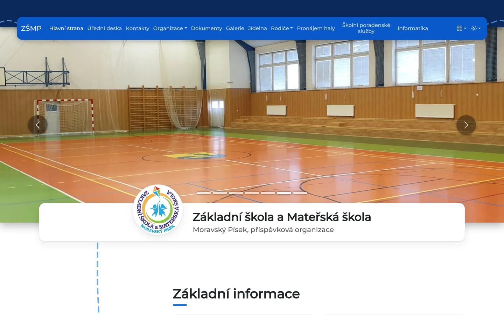   | 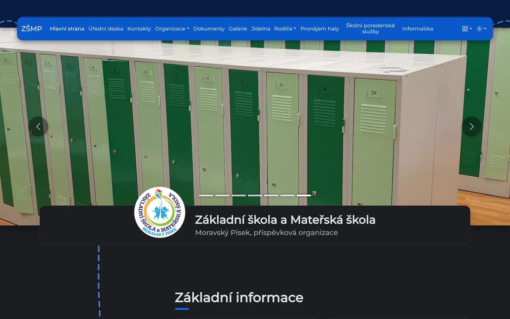 |
| 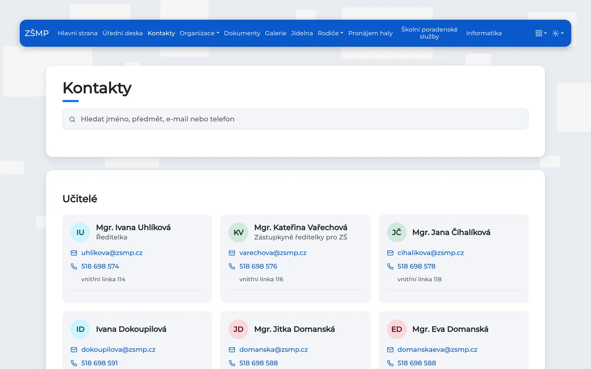 | 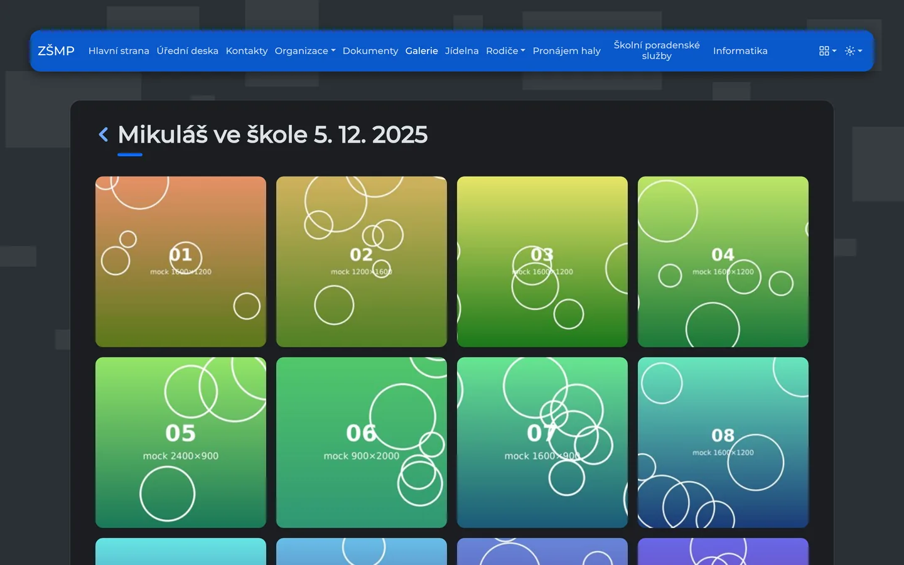            |

On a phone:

| Home                                                            | Home, dark                                                                 | Photo archive                                                          | School year                                                                               |
| --------------------------------------------------------------- | -------------------------------------------------------------------------- | ---------------------------------------------------------------------- | ----------------------------------------------------------------------------------------- |
| 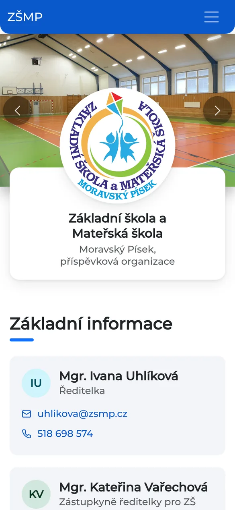 | 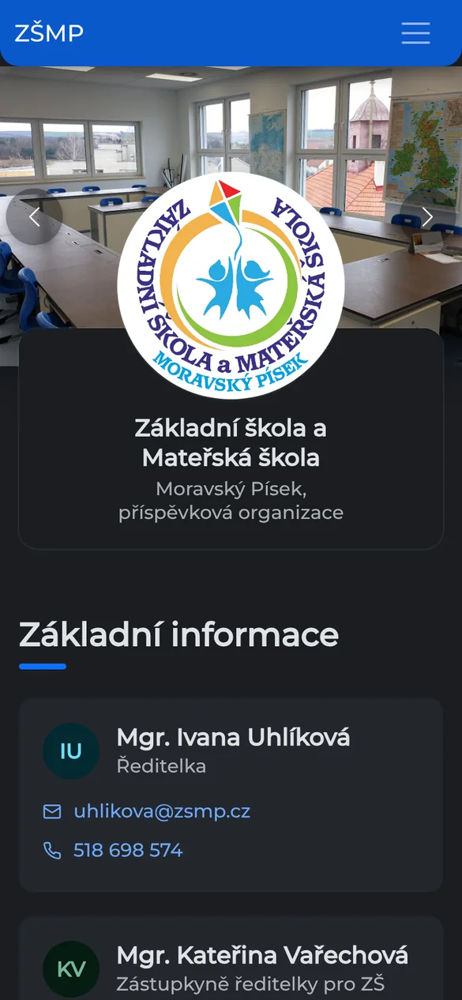 | 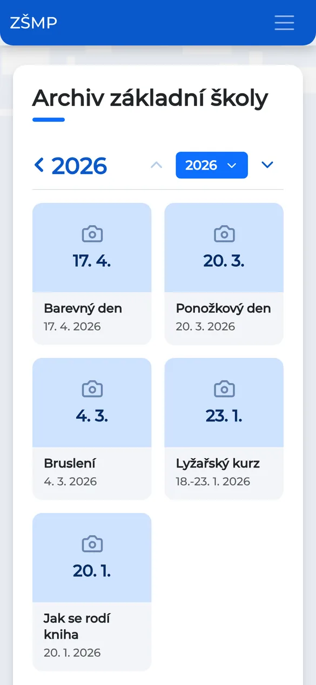 | 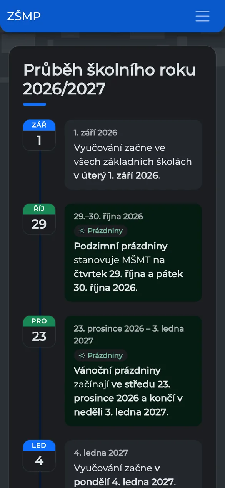 |

The admin:

|                                                             |                                                               |
| ----------------------------------------------------------- | ------------------------------------------------------------- |
| 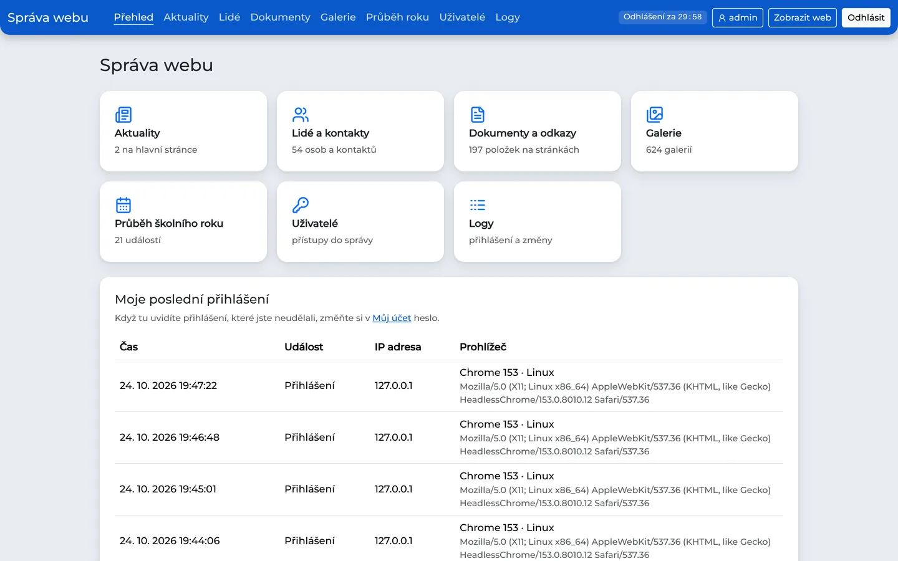   | 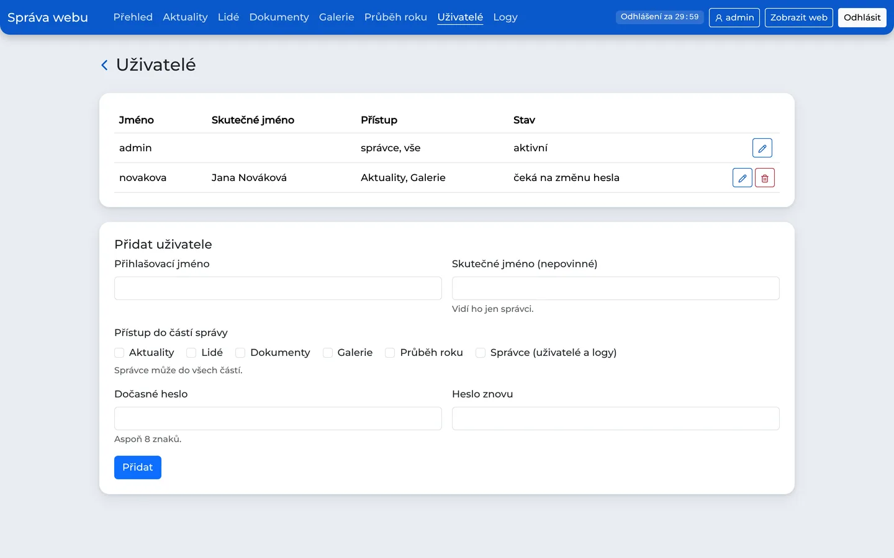  |
| 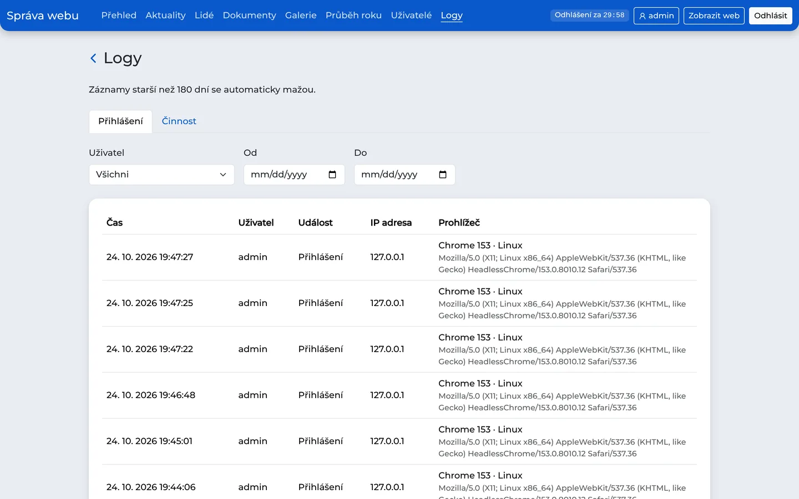                   | 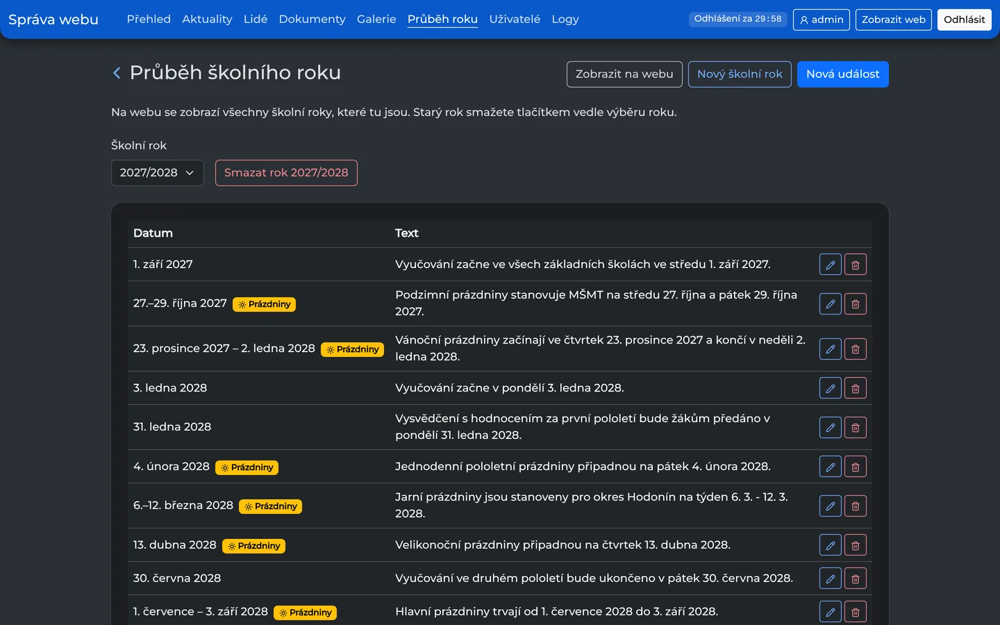 |
| 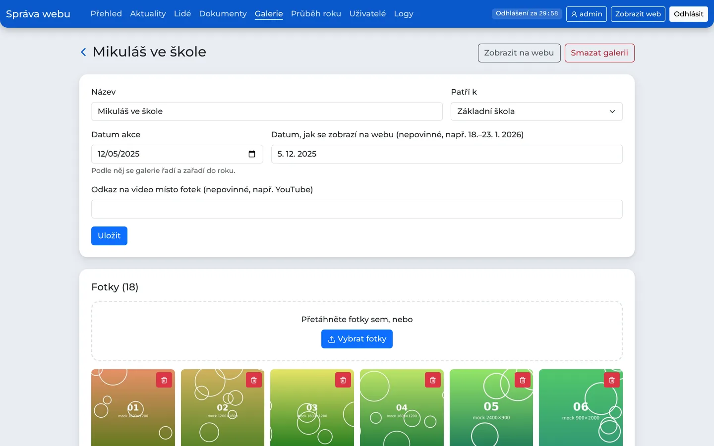 | 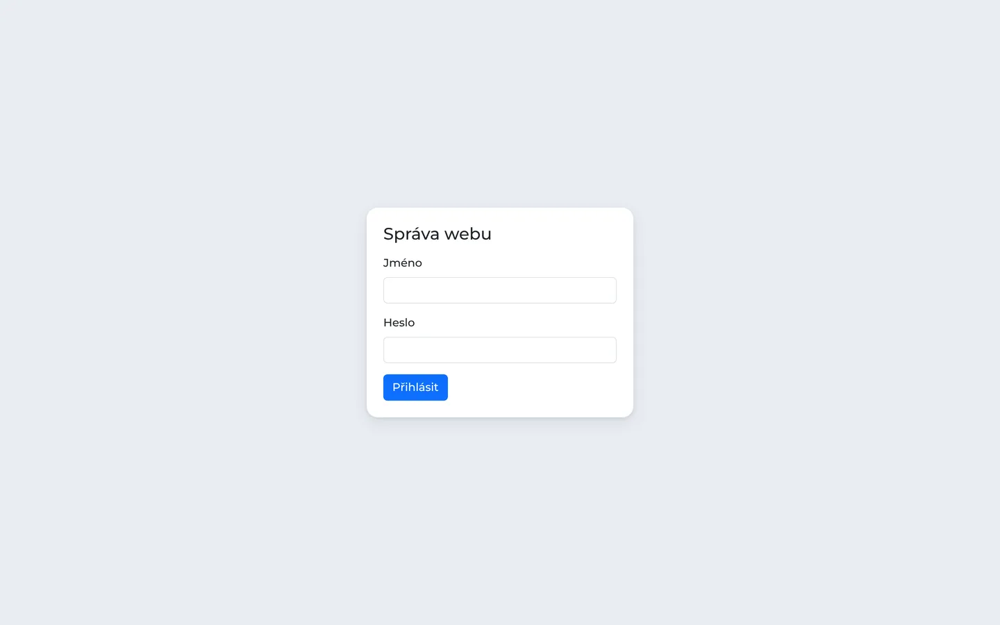            |

## Run with Docker

The site runs as three containers: `web` (Next.js with the admin, `src/web`), `db` (PostgreSQL 18, `src/db`) and `migrate`, which runs once on every start: it applies new database migrations and fills an empty database.

```bash
cp .env.example .env    # then set a real POSTGRES_PASSWORD
docker compose up -d --build
```

The site is then on http://localhost:3000.

## Admin (`/auth`)

`/admin` is the sign-in page. It is not linked from the site and is hidden from search engines (`noindex`, `robots.txt`). The first user is **admin / zsmp** and has to choose its own password after signing in; until then _Můj účet_ is the only page it can open. Everything else lives under `/auth`, and every page and every change checks the session on the server.

| Section         | What it edits                                                                                   | Permission        |
| --------------- | ----------------------------------------------------------------------------------------------- | ----------------- |
| Aktuality       | news on the home page (title, date, text, optional link, published or not)                      | `aktuality`       |
| Lidé            | people and phone numbers on Kontakty, the home page and the other pages                         | `lide`            |
| Dokumenty       | the lists of documents and links on every page: upload a file or enter a link, replace, reorder | `dokumenty`       |
| Galerie         | galleries of the three archives (ZŠ, MŠ, družina) and their photos                              | `galerie`         |
| Průběh roku     | the calendar on _Průběh školního roku_                                                          | `kalendar`        |
| Pozadí          | seasonal pictures behind the top of the pages: name, SVG/PNG/WebP upload, date range each year  | `pozadi`          |
| Uživatelé, Logy | user accounts and the logs                                                                      | `admin` (Správce) |

- **Access (ACL):** an admin gives each user the sections they may edit. _Správce_ can do everything, including Uživatelé and Logy. A section a user has no access to is hidden from their menu, and opening it anyway sends them back to the start page. Real names of users are visible only to admins. Every user changes their own sign-in name and password under _Můj účet_ (`/auth/ucet`); both changes need the current password.
- **Logs:** sign-ins, sign-outs, wrong passwords, locked accounts and account changes (with the IP address and browser), and every change made in the admin (who, when, what). Admins see them under _Logy_ (`/auth/logy`), filtered by user and date; every user sees their own last sign-ins on the start page, to notice one they didn't make. Entries are deleted after `LOG_RETENTION_DAYS` (180 by default), because IP addresses are personal data (GDPR).
- **Time limits** (`src/web/lib/auth/config.ts`, each one can be changed in `.env` without a rebuild): sign-out after `AUTH_INACTIVITY_MINUTES` (30) without activity, counted down by the timer in the header; the server ends the session too, even with the tab closed. A sign-in lasts at most `AUTH_SESSION_MAX_MINUTES` (480). `AUTH_LOCKOUT_ATTEMPTS` (5) wrong passwords in a row lock the account for `AUTH_LOCKOUT_MINUTES` (10); an admin can unlock it under Uživatelé.
- **Pozadí:** each background has a date range that repeats every year and may wrap past New Year (1. 12. – 31. 1.); one without dates is the default for all other days, and when ranges overlap the shorter one wins. Pages load `/pozadi`, a 5-minute redirect to today's picture, so pages stay static and a change shows up within minutes. Uploads go to `pozadi/` in the media folder; the original three pictures stay in `public/data/images/background_elements/`.
- **Průběh roku:** events with a date (or a date range), the school year they belong to, a text (`**bold**` works) and a holiday flag; holidays are green on the site. A new school year starts empty or as a copy of an earlier one with every date moved by a year, and a whole year can be deleted.
- **Galleries:** a gallery has a title, a unit (ZŠ, MŠ, družina), a date, optionally the date as shown on the site (e.g. "18.–23. 1. 2026") and a video link (e.g. YouTube) instead of photos. Archives are ordered by year and date, newest first. Photos are dragged onto the page and uploaded one by one with a progress bar; the server rotates them by their EXIF data and makes the previews (`thumbnails/`, short side 256 px). Single photos or whole galleries can be deleted.

The sign-in cookie (`zsmp_session`, httpOnly) only travels over HTTPS (IIS). To try the admin over plain http, e.g. http://192.168.100.10:3000, set `COOKIE_SECURE=false` in `.env` for that time. The database keeps only a hash of the cookie's token.

## Privacy (GDPR)

The public site stores nothing about visitors: no analytics, no ads, no third-party scripts or fonts (Montserrat is served by the site itself). The browser keeps only the chosen theme, the list layout and that the cookie notice was read, in `localStorage`; the cookie notice says so. The admin stores the sign-in cookie and the logs described above, which are deleted after `LOG_RETENTION_DAYS`.

## Photos, documents and videos

They are not in git or in the image. They live in a folder on the server (`MEDIA_DIR` in `.env`, default `./media`), which is mounted into the web container, so they survive rebuilds:

```
media/
  galerie/<folder>/...   → /galerie/<folder>        (photos, thumbnails/ = previews)
  dokument/...           → /dokument/...
  pozadi/...             → /pozadi/...              (background pictures uploaded in Pozadí)
  videos/zsmp.mp4, zsmp.cs.vtt → /data/videos/...
```

The admin uploads into `galerie/`, `dokument/` and `pozadi/`, so the folder must be writable for the container's user (uid 1000): `sudo chown -R 1000:1000 media`. New files are served right away.

## Database

- The data lives in the Docker volume `db-data`, which survives restarts and rebuilds. Back it up with `docker compose exec db pg_dump -U zsmp zsmp > backup.sql`.
- Prisma owns the tables: `src/web/prisma/schema.prisma` and the migrations in `src/web/prisma/migrations/`. The `migrate` service applies them on every `docker compose up`.
- The first content (as it was in `src/web/data/*.ts`) is `src/web/prisma/seed/content.sql`; it is loaded only into an empty database. From then on the content is edited in the admin.
- If you started the database before Prisma took over (its tables came from `src/db/init/`), either start from scratch with `docker compose down -v` (this deletes all data in it) or keep it with `docker compose run --rm migrate npx prisma migrate resolve --applied 0_init` and then `docker compose up -d`.
- The database listens only on 127.0.0.1:5432 inside the VM. To open it in DBeaver or pgAdmin, use their SSH tunnel option to the VM.

## IIS

IIS stays the public web server and forwards requests to the `web` container, so no nginx is needed. `deploy/iis/web.config` is the site's config: it needs the IIS modules [URL Rewrite](https://www.iis.net/downloads/microsoft/url-rewrite) and [Application Request Routing](https://www.iis.net/downloads/microsoft/application-request-routing) (in ARR's _Server Proxy Settings_, tick _Enable proxy_; in URL Rewrite's _View Server Variables_, add `HTTP_X_FORWARDED_PROTO` and `HTTP_X_FORWARDED_HOST`). HTTPS certificates stay in IIS.

## Server setup (Windows Server 2019)

Windows Server 2019 cannot run Linux containers, so Docker runs in a small Ubuntu VM in Hyper-V and IIS forwards to it:

```
internet → IIS (HTTPS, port 443) → VM 192.168.100.10:3000 → web container → db container
```

1. Add the Hyper-V role. In PowerShell (as admin), create a private switch that only the server can reach, with internet access through NAT:
   ```powershell
   New-VMSwitch -Name zsmp -SwitchType Internal
   New-NetIPAddress -IPAddress 192.168.100.1 -PrefixLength 24 -InterfaceAlias "vEthernet (zsmp)"
   New-NetNat -Name zsmp -InternalIPInterfaceAddressPrefix 192.168.100.0/24
   ```
2. Create a Generation 2 VM on the `zsmp` switch (2 CPUs, 4 GB RAM, a disk with room for the photos) and install Ubuntu Server 24.04 LTS with OpenSSH. Give it the static address 192.168.100.10/24, gateway 192.168.100.1, DNS e.g. 1.1.1.1. In the VM settings, set _Automatic Start Action_ to always start.
3. In the VM, install Docker Engine (https://docs.docker.com/engine/install/ubuntu/), clone this repo, create `.env` with `WEB_BIND=192.168.100.10`, and run `docker compose up -d --build`. The containers start again by themselves after a reboot.
4. Put the existing photos, documents and videos into `media/` in the VM (e.g. with WinSCP over SSH) and run `sudo chown -R 1000:1000 media`.
5. In IIS, point the site at a folder holding `deploy/iis/web.config` and set up the modules as described in the IIS section above.

Back up the VM (Hyper-V checkpoint or Windows Server Backup) and the database dump regularly; the photos and the database live on the VM's disk.
